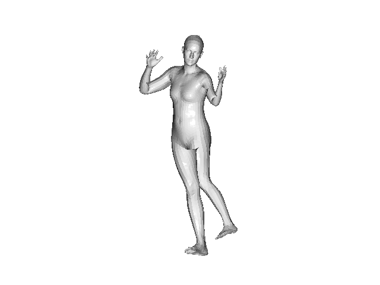

# CV, ML exploration and useful snippets in Python 

* Kalman filtering
* 3D reconstruction from human body
  * SMPL
  * 4D-Humans
* VLM 

# 3D reconstruction  from human body

Unlike other Structure-From-X (motion, structured light, stereo vision, shap) techniques, human bodies are well understood. Given a 2D image uplifting, that is producing 3D mesh is possible. 

The main idea is to have a model many human body shapes parameterized by a few parameters, such as pose, shape and others. This started in 2012 and this time there appears to be two models, SMPL-ish (Simple Multiperson Linear Model) and 4D-Humans / HRM2.0

## SMPL

1. Get input human body keypoints (face, torso, arms, legs, knees, elbows, etc.) from 2D image
2. Parameterize SMPL parameters (pose and shape) with the given keypoints. There is an iterative gradient descent optimization algorithm. It starts with random parameters, projects 3D back to 2D (inverse projection), compute loss from the input keypoints and moves into the right direction. It runs in less than a second with a few hundred iteration.  

On the first try the reconstruction is very rough    

## 4D-Humans / HRM2.0

This produces significant improvement with a very short amount of code. This is the same SMPL model, but the results are day and night.    

